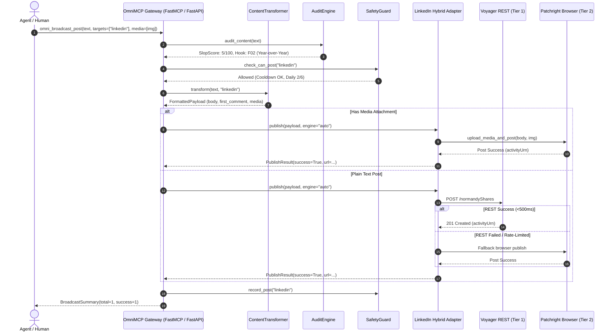

# Architecture Specification

## Project: OmniMCP Pro
**The Protocol-Native Social Media Operating System & Command Center**

---

## 1. System Architecture Overview

OmniMCP Pro is structured around a decoupled, clean-architecture pattern that allows the same underlying publishing and intelligence engine to serve both:
1. **Autonomous AI Agents** via the Model Context Protocol (MCP) over `stdio` and `streamable HTTP`.
2. **Human Creators & Developers** via a high-performance **Web Command Center** (FastAPI backend + Vite/React frontend).

```
                                  [Agentic Clients]                [User Browser]
                              (Claude Code, Antigravity,               (Web UI)
                                  Cursor, Codex)                           │
                                         │                                 │
                                         │ JSON-RPC (stdio/HTTP)           │ REST / SSE
                                         ▼                                 ▼
                     ┌─────────────────────────────────────────────────────────────┐
                     │                     OmniMCP Pro Gateway                     │
                     │  ┌─────────────────────────────┐  ┌──────────────────────┐  │
                     │  │   Protocol Layer (FastMCP)  │  │  Web API (FastAPI)   │  │
                     │  │   - JSON-RPC over stdio     │  │  - Dashboard Routes  │  │
                     │  │   - Streamable HTTP / SSE   │  │  - SSE Live Feeds    │  │
                     │  └──────────────┬──────────────┘  └──────────┬───────────┘  │
                     └─────────────────┼────────────────────────────┼──────────────┘
                                       │                            │
                                       ▼                            ▼
                     ┌─────────────────────────────────────────────────────────────┐
                     │                  Core Orchestration Engine                  │
                     │  ┌───────────────────────────┐  ┌────────────────────────┐  │
                     │  │   ContentTransformer      │  │   AuditEngine          │  │
                     │  │   - Platform formatting   │  │   - 2026 AI Slop radar │  │
                     │  │   - 1st-comment link-drop │  │   - F01-F20 Hook score │  │
                     │  │   - Twitter thread chunker│  │   - Fold cutoff check  │  │
                     │  └──────────────┬────────────┘  └───────────┬────────────┘  │
                     │                 │                           │               │
                     │  ┌──────────────┴────────────┐  ┌───────────┴────────────┐  │
                     │  │   SafetyGuard             │  │   ContentScheduler     │  │
                     │  │   - 3-min cooldown guard  │  │   - 7-day, 35-post cal │  │
                     │  │   - Daily frequency limit │  │   - Velocity score     │  │
                     │  │   - Human jitter delays   │  │   - Reach learner loop │  │
                     │  └──────────────┬────────────┘  └───────────┬────────────┘  │
                     └─────────────────┼───────────────────────────┼───────────────┘
                                       │                           │
                                       ▼                           ▼
                     ┌─────────────────────────────────────────────────────────────┐
                     │                  Platform Adapter Registry                  │
                     │  ┌─────────┐  ┌───────────┐  ┌─────────┐  ┌──────────────┐  │
                     │  │ Twitter │  │ WordPress │  │ Threads │  │   Facebook   │  │
                     │  │ v2 API  │  │ REST API  │  │ Graph   │  │  Pages Graph │  │
                     │  └─────────┘  └───────────┘  └─────────┘  └──────────────┘  │
                     │                              │                              │
                     │                              ▼                              │
                     │        ┌───────────────────────────────────────────┐        │
                     │        │          Hybrid LinkedIn Adapter          │        │
                     │        │  ┌─────────────────────────────────────┐  │        │
                     │        │  │ Tier 1: Voyager REST API            │  │        │
                     │        │  │ - /voyager/api/me (<300ms)          │  │        │
                     │        │  │ - /normandyShares post (<500ms)     │  │        │
                     │        │  │ - Fast comment drops                │  │        │
                     │        │  └──────────────────┬──────────────────┘  │        │
                     │        │                     │ Fallback / Media    │        │
                     │        │  ┌──────────────────▼──────────────────┐  │        │
                     │        │  │ Tier 2: Patchright Browser Engine   │  │        │
                     │        │  │ - Image / Media file chooser upload │  │        │
                     │        │  │ - Deep profile scraping             │  │        │
                     │        │  │ - Search (Jobs, People, Posts)      │  │        │
                     │        │  │ - Messaging & Networking DMs        │  │        │
                     │        │  └──────────────────┬──────────────────┘  │        │
                     │        └─────────────────────┼─────────────────────┘        │
                     └──────────────────────────────┼──────────────────────────────┘
                                                    ▼
                     ┌─────────────────────────────────────────────────────────────┐
                     │                 Session & Credential Store                  │
                     │  - ~/.omnimcp/ or .env (li_at, JSESSIONID/csrf-token)       │
                     │  - Chrome persistent profile / Automated cookie refresher   │
                     └─────────────────────────────────────────────────────────────┘
```

---

## 2. Component Breakdown

### 2.1 Protocol & API Gateway (`backend/src/api` & `backend/src/mcp_server`)
- **FastMCP Protocol Handler**:
  - Exposes typed tools (`omni_broadcast_post`, `omni_preview_broadcast`, `omni_audit_content`, `omni_get_calendar`, `omni_publish_scheduled_post`, `omni_record_reach_metrics`).
  - Dual transports: `stdio` for local coding assistants and Streamable HTTP (`/mcp`) for networked agents.
- **FastAPI Web Service**:
  - Mounts REST endpoints:
    - `/api/posts`: Compose, dry-run preview, broadcast, live audit.
    - `/api/calendar`: 7-day schedule CRUD, one-click execution, manual schedule additions.
    - `/api/analytics`: Engagement velocity metrics, hook performance rankings, AI recommendations.
    - `/api/platforms`: Health check, active connection status, one-click Chrome session refresh.
    - `/api/safety`: Live cooldown timers and daily limit counters.
  - Server-Sent Events (SSE) at `/api/events` for streaming real-time publishing status and browser step logs.

### 2.2 Hybrid LinkedIn Engine (`backend/src/platforms/linkedin`)
The LinkedIn adapter employs a **two-tier execution hierarchy**:

#### Tier 1: High-Speed Voyager REST API (`rest_client.py`)
- Used for:
  - Text-only feed posts
  - Profile identity and session health (`/voyager/api/me`)
  - First-comment link drops
  - Direct comment creation
- **Performance**: Completes in **~300ms to 500ms** (50x faster than browser launch).
- **Authentication**: Uses `li_at` cookie and `csrf-token` (`JSESSIONID`) with normalized browser headers (`x-restli-protocol-version: 2.0.0`).
- **Resilience**: If Voyager `/normandyShares` returns an unexpected schema, automatically falls back to Voyager UGC `/ugcPosts`.

#### Tier 2: Hardened Patchright Browser Engine (`browser_engine.py`)
- Used when:
  - An image or media file is attached (`media_paths=[...]`).
  - Deep reading is requested (profile scraping, experience, skills, education).
  - Search tools are invoked (people, jobs, posts).
  - Messaging or network connection invites are requested.
  - Tier 1 REST encounters an unexpected login challenge or rate-limit.
- **Stealth Protection**: Built on Patchright (un-detectable Chromium with synchronized client hints, WebRTC UDP proxy containment, and downgrade prevention).
- **Media Upload Pipeline**:
  1. Trigger "Start a post" modal on feed.
  2. Intercept file chooser on `button[aria-label="Media"]`.
  3. Upload local image file (`file_chooser.set_files(...)`).
  4. Wait for secondary preview modal and click `Next`.
  5. Fill text editor and dispatch `Post` button with verified activity URN extraction.

### 2.3 Cross-Platform Transformation (`backend/src/core/transformer.py`)
Single master content is transformed into platform-native formats via `ContentTransformer`:
- **LinkedIn**:
  - Max 3,000 characters.
  - Strips external URLs from the post body and attaches them to `first_comment` (`🔗 Link: <url>`) to preserve algorithmic reach.
  - Formats the opening 140 characters as a high-retention hook before the fold.
- **X (Twitter)**:
  - Max 280 characters.
  - Intelligent sentence-aware thread chunking with `1/n`, `2/n` pagination indicators.
- **Threads**:
  - Max 500 characters with native hashtag spacing.
- **WordPress**:
  - Converts Markdown into clean, semantic HTML (`<h1>`, `<h2>`, `<pre><code>`, `<blockquote>`, `<p>`).
  - Generates post tags and categories.
- **Facebook**:
  - Page-feed friendly layout with inline link previews.

### 2.4 AI-Slop Auditor & Reach-Learning Strategy (`backend/src/core/audit.py` & `scheduler.py`)
- **Slop Penalty Radar**:
  - Scans for 2026 AI clichés: *"delve"*, *"tapestry"*, *"testament"*, *"in today's fast-paced digital world"*, *"beacon"*, *"multifaceted"*, *"staccato bullet stacks"*.
  - Assigns a slop score (0 = Human, 100 = Synthetic AI Slop).
- **Hook Classifier (F01–F20)**:
  - Matches the opening lines against 20 proven formulas from Serge Bulaev's framework (Obituary, Year-over-Year, Contrarian, Cold Open, Hard Numbers, etc.).
- **Reach Learning Loop**:
  - Stores engagement metrics for published posts.
  - Computes Engagement Velocity:
    $$\text{Velocity} = \frac{(\text{Reactions} \times 2) + (\text{Comments} \times 5)}{\max(1, \text{Impressions})}$$
  - Groups performance by Hook Type and Topic Theme, dynamically weighting future recommendations toward high-velocity styles.

---

## 3. Data Flow Diagram



---

## 4. Frontend Architecture (`frontend/`)

Built as a dark-mode command center optimized for speed and visual clarity.

### 4.1 Tech Stack
- **Framework:** Vite + React 19 + TypeScript
- **Styling:** Vanilla CSS Custom Properties (Theme tokens, glassmorphism, fluid typography)
- **State & Querying:** Lightweight custom hooks + Fetch API + Server-Sent Events (SSE)
- **Icons:** SVG icon system (zero heavy external font bundles)

### 4.2 Views & Components
1. **Omni Composer**:
   - Master textarea with auto-resizing.
   - Live AI Slop Highlighter (underlines cliché phrases in real time with suggestions).
   - Hook Formula dropdown (F01–F20 with live templates).
   - Media upload drag-and-drop zone.
   - Platform toggle pills (LinkedIn, X, Threads, WordPress, Facebook).
2. **Multi-Platform Preview Card Suite**:
   - **LinkedIn Card**: Renders author avatar, name, headline, post text with fold button ("...see more"), media preview, and pinned first comment link.
   - **X (Twitter) Thread Preview**: Displays stacked tweet cards (`1/n`, `2/n`, etc.) with 280-character boundary rings.
   - **WordPress Card**: Displays article title, semantic HTML preview, and tags.
3. **7-Day Interactive Calendar**:
   - Interactive matrix displaying the 35 posts across 5 global time slots.
   - Status chips: `PENDING`, `PUBLISHED`, `FAILED`, `SKIPPED`.
   - "Publish Now" button with modal confirmation and live progress animation.
4. **Analytics & Reach-Learning Lab**:
   - Velocity score charts and historical trend lines.
   - Top-performing hook rankings.
   - AI recommendations for future post themes.
5. **Safety & Session HUD**:
   - Real-time cooldown countdown clock.
   - Daily post gauge (`X / 6 posts`).
   - Cookie status indicator with one-click refresh button.

---

## 5. Security & Safety Model
- **Local-First Credential Isolation**: Cookies and API keys reside strictly in `~/.omnimcp/` or local `.env`. Never committed, never sent to external servers.
- **Anti-Ban Enforcement (`SafetyGuard`)**: Hard minimum 180s cooldown and 6 posts/day cap strictly enforced across all adapters.
- **Write Gate**: All mutating operations require explicit confirmation (`confirm_post=True`) or `OMNI_WRITE_ENABLED=true` environment flag.
